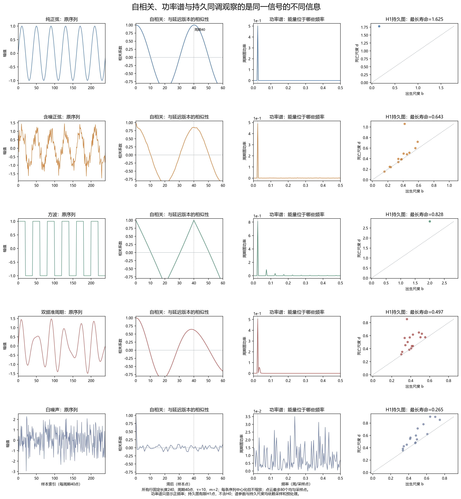

# 第三阶段：自相关、功率谱与持久同调看的是同一条序列的什么信息？

日期：2026年11月3日。目标：把拓扑特征与两个熟悉的时间序列工具放在一起观察，区分它们描述的信息，不比较分类或预测性能。

## 实验设置

生成5条等长为240的合成序列；正弦周期为40个采样点，其余信号均在同一时间索引上构造：

- 纯正弦：单一周期结构。
- 含噪正弦：正弦加标准差0.3的独立高斯噪声。
- 方波：周期与正弦相同，但波形不同，谐波结构更丰富。
- 双频准周期：周期40正弦与另一非整数频率正弦相加。
- 白噪声：无设定周期，有限样本中仍会有随机波动和偶然谱峰。

五种方法都在相同的原始序列上计算：

1. **自相关**：序列与按滞后量平移后的版本的相似程度。先减去均值，计算每个滞后的重叠乘积，再除以有效重叠数，最后以0阶相关归一化。这个有限样本估计会在高滞后下较波动；这里的相位、数值还受估计约定影响。
2. **功率谱**：用箱形窗、去均值的periodogram估计能量分布。采样率设为每个采样单位一个单位，横轴是“周/采样点”。最长时段的频率分辨率受记录长度限制。
3. **持久同调**：构造`(x(t),x(t+10))`二维延迟点云，即m=2、τ=10，均匀取最多80点，在欧氏距离的Vietoris–Rips过滤下计算H1。每条序列先减去均值，但不缩放幅值。右列显示H1有限寿命点；无限死亡的H0不在该图中。



## 实际结果

| 信号 | 自相关：滞后40 | 最大谱峰对应周期（点） | 主谱峰功率占比 | H1有限特征数 | 最大H1寿命 |
|---|---:|---:|---:|---:|---:|
| 纯正弦 | 1.000 | 40.00 | 1.000 | 1 | 1.625 |
| 含噪正弦 | 0.852 | 40.00 | 0.864 | 13 | 0.643 |
| 方波 | 1.000 | 40.00 | 0.812 | 1 | 0.828 |
| 双频准周期 | 0.629 | 40.00 | 0.805 | 16 | 0.497 |
| 白噪声 | -0.019 | 4.21 | 0.037 | 16 | 0.265 |

以上谱峰和持久寿命在同一种各自的定义与单位下可读；**不能直接按数字大小横向比较不同方法**。谱峰功率占比是归一化功率的比例；H1寿命是在当前原始幅值尺度上测量的距离；自相关是无量纲相关系数。

## 怎样解读

**纯正弦：**自相关在40点处再次达到1，功率集中在0.025周/采样点，H1呈一个远离对角线的特征。这三种方式都与明显周期信号相符，但各自回答的问题不同：相似性、频率、几何环结构。

**含噪正弦：**自相关和功率谱仍显示40点周期；H1中则出现许多有限特征。一个较长的特征并未保留干净正弦时的寿命。点数、有限样本、噪声及Rips过滤共同决定这些H1点。

**方波：**周期仍然是40，但能量不再集中于单一频率，功率谱包含谐波。这个点云仍然围成一条主要环，不过其几何形状和持久寿命与正弦不同。拓扑和频谱在保留的信息上不同。

**双频准周期：**单个最大谱峰可以报告主频，但不会完整总结所有频率分量；H1图则会出现多项几何特征。H1数量增加不等于结构更丰富、更重要或类别更容易区分。

**白噪声：**最大谱峰对应4.21点，并不表示信号真的有4.21点周期，这是在大量近似平坦的随机功率值里选出来的最大值。它也产生16项有限H1特征、总寿命1.698（见结果文件），甚至超过纯正弦的总寿命1.625。这是一个重要反例：无周期信号也可以产生不少拓扑特征，拓扑摘要不能脱离基线和生成机制解释。

## 三种方法分别适合问什么？

| 方法 | 它直接描述什么 | 这组实验中清楚看见什么 | 单独使用时不回答什么 |
|---|---|---|---|
| 自相关 | 不同滞后之间的线性相关结构 | 周期重复导致的滞后峰 | 复杂频率分量的能量分配或一般因果关系 |
| 功率谱 | 频率分量与信号功率的分布 | 主频、方波谐波、随机噪声较平坦的谱 | 时变局部结构或相位如何随时间变化 |
| 持久同调 | 所选点云在不同距离尺度下的连通和环 | 延迟嵌入中的环状结构、多尺度几何特征 | 周期是否真实、类别是否可区分、下一时刻数值 |

这些描述并非互斥。做研究时可以把它们作为竞争解释、对照特征，或互补输入；使用“融合更好”之前，要确保模型、调参预算和数据切分公平。

## 本实验能支持和不能支持什么

**可以支持：**周期信号的周期可同时反映在自相关峰、谱峰和合适参数下的点云结构里；改变波形会改变频谱与几何摘要；噪声及随机信号也可能产生H1点。

**不能支持：**拓扑优于自相关或功率谱；H1寿命能估算周期；出现许多H1特征即代表高复杂度或有用机制；这五条信号上的观察可推广至真实数据或某一具体预测任务。

尤其要注意本实验没有统一数值尺度：持久性基于原始幅值距离，所以幅值变化会改变数值寿命；功率谱的功率按幅值平方变化；自相关会去均值且不随整体乘正数变化。下一步如比较同一信号的幅值变换，必须明确目的，并设计一致的预处理对照。

## 自测与下一步

1. 白噪声谱上最大峰给出的周期为什么不等于“发现了真实周期”？
2. 为什么方波和正弦的周期相同，但谱结构和H1寿命不同？
3. 白噪声的有限H1点说明“有持久特征”为什么不足以证明有意义的周期结构？
4. 为什么不能把最大H1寿命0.265和谱峰占比0.037直接比较大小？
5. 如果持久性很高，但目标是预测下一步方向，接下来还需要什么任务实验？

本阶段完成后，应能按“拓扑额外描述了什么、普通方法已能解释什么、哪种任务才可能体现互补价值”筛选课题。下一步可以对一个真实数据分类或结构变化任务，先固定训练/验证方案，再公平比较统计、频谱、持久同调及特征融合；目前这份合成对照不证明融合有益。

## 复现

```powershell
Set-Location 'D:\Projects\topology-time-series'
& 'D:\Anaconda3\envs\tda\python.exe' experiments/06_classical_vs_topology.py
```

- `01_method_comparison.png`和`.svg`：五行合成信号的比较图。
- `summary.csv`：五个信号的主要定量摘要。
- `results.json`：信号生成配置、估计方法、软件版本与完整结果。
