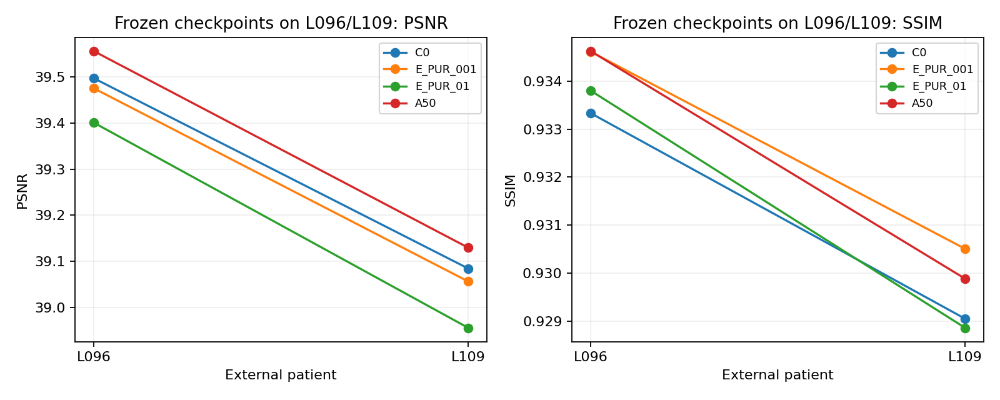

# 课后作业：将实验结果整理与论文小节写作固化为 Skill

日期：2026年11月9日

## 一、我为什么选择这项工作

我目前主要在探索拓扑与 LDCT 去噪、拓扑与多变量时间序列、自监督预训练教师指导的 LDCT 去噪三个方向。这些研究都需要不断做实验、保存结果，并判断结果能支持什么结论。

我原来的习惯是：一有实验结果，就把图表复制到 PPT，再补充一两句话，说明这组数据是做什么的。这种方式方便展示，但对实验条件、比较口径、结果解释和后续写作的记录不够系统。等到正式写论文时，我往往又需要花一至两周，重新翻找文件、梳理实验和组织描述。这个时间是我对以往整理阶段的回忆估计，并非精确计时，也不是单个论文小节的写作时间。

因此，我把这次作业的范围定为：**每次产生一组实验结果，就将其整理成可追溯的结果卡；需要写论文时，再根据这些材料形成一个 Results/Discussion 小节。** 我希望先解决结果保存与论文写作之间的断层，让日常记录能够在正式写作时复用。

这项工作在我的研究中反复出现。已有时间序列项目中，第一阶段的持久图解释、第二阶段的噪声对照、第三阶段的经典工具与拓扑比较，都涉及“整理结果—解释现象—限定结论”的过程。三份报告正文日期分别为2026年11月2日、11月2日和11月3日，相关标题、日期和文件哈希见[既有报告记录](records/prior-report-evidence.json)。我没有逐次记录当时的整理耗时，因此不为这些历史任务补造计时数据。

## 二、我将哪些经验写进了 Skill

我将技能命名为 `evidence-based-paper-writing`，主要保留以下工作步骤：

1. 明确这组实验要回答的问题，整理实验对象、对照、指标、单位与数据划分。
2. 为原始材料建立清单和哈希，保存本轮写作使用的输入版本。
3. 先建立论断与证据的对应，再组织结果段落。
4. 由脚本核对来源位置、原始数值、差值计算与草稿标记。
5. 保存结果卡、论文小节初稿和仍需核实的问题。

其中，文件完整性、文本行号、CSV行列、JSON路径和数值计算交给确定性脚本；段落组织和解释建议由 AI 辅助完成；实验设计、创新性和最终科学解释仍需要我结合研究背景判断。

我在 `SKILL.md` 中明确了使用边界：不能补造实验、引用和数字，不能把单次结果写成稳定规律，不能把相关性写成因果关系，也不能仅凭一个指标改善就宣称方法全面更优。没有原始材料支撑时，应列出缺口，不能继续生成实验结论。

技能编写、脚本实现和初稿整理使用了 AI 辅助。我的目标是把整理过程固定下来，同时让生成内容有据可查。

## 三、我如何用已有研究材料实测

这次实测使用以下三个项目的真实已有材料：

| 项目 | 原始目录 | 选取内容 |
|---|---|---|
| 拓扑与 LDCT 去噪 | `D:\Projects\tda-learning` | 冻结包中的 L310 图像与特征汇总、决策和方法说明 |
| 拓扑与时间序列 | `D:\Projects\topology-time-series` | 第三阶段合成信号对照的 CSV、JSON 和报告 |
| DINO 教师与 LDCT 去噪 | `D:\Projects\FPKD-CT` | 稳定性与架构筛查结果、协议和项目总述 |

我以 FPKD-CT 为主案例，再用另外两个项目检查这套流程能否迁移。这里整理的是已经完成的实验结果，没有重新训练模型，也没有运行新的医学实验。输入副本与原始材料的对应见[来源映射](records/source-map.json)，13个选定来源及副本的哈希核对结果见[完整性记录](records/source-integrity.json)。

### 1. 主案例：保留指标之间的权衡

FPKD-CT 的已有稳定性报告包含模型指标和增量，但要复查一条描述，仍需回到嵌套 JSON 中找到模型、指标及汇总口径。我用技能为这些描述建立了明确的源路径和计算规则。

以 E_PUR_001 相对 C0 的比较为例，在 L096/L109 的切片合并均值口径下，脚本重算得到：

| 指标 | 差值（E_PUR_001 − C0） | 方向 |
|---|---:|---|
| SSIM | +0.0013309624261381 | 增加 |
| PSNR | −0.02355913875161 dB | 下降 |
| MAE | +0.0000506307988164775 | 增加 |

这组结果提醒我，SSIM 的改善不能直接写成整体去噪效果提高。我在初稿中同时保留了 PSNR 和 MAE 的不利变化，将其描述为指标权衡。详细定位与容限见[核验报告](cases/fpkd-ct/verification.json)和[论断证据表](cases/fpkd-ct/review.md)。

下面是原项目已有的患者指标图：



该图来自原项目 `results/figures/stability_ablation_20261109_v1/external_patient_metrics.png`。图中的“external”应结合项目记录理解：L096/L109 是同来源、未参与该模型训练且已经被开发观察的患者，因此我将其用于开发验证描述，而不是独立来源测试或临床结论。图中连线只是帮助比较指标方向。

### 2. 另外两个案例：限制结论的范围

在拓扑去噪案例中，GATED_TRUST 减少了选定 safe 特征子组的附带误差，但平均 PSNR 并没有提高，而且这仍是 L310 单患者的开发评价。因此，我分别保留了特征层面和图像层面的结果。

在时间序列案例中，白噪声也出现了有限 H1 特征，且其 H1 总寿命高于纯正弦。这组实验有助于理解拓扑摘要的解释边界，但没有比较预测性能，所以不能据此写出“拓扑提高了多变量时间序列预测精度”。

### 3. 实际运行与输出

核验命令如下，在仓库根目录运行：

```powershell
python -X utf8 scripts/replay_cases.py
```

首次运行记录如下，完整命令、输出和退出码保存在[运行日志](records/runs/20261109T132216876728Z/run.json)。下列时间只表示脚本执行耗时，不代表完整写作耗时。

```text
fpkd-ct-inventory: exit=0; 0.066318s
fpkd-ct-check: exit=0; 0.065630s
tda-ldct-inventory: exit=0; 0.059556s
tda-ldct-check: exit=0; 0.066840s
topology-time-series-inventory: exit=0; 0.063093s
topology-time-series-check: exit=0; 0.064612s
boundary-tests: exit=0; 0.241811s
```

| 案例 | 登记证据 | 登记论断 | 派生计算 | 机械核验 |
|---|---:|---:|---:|---|
| FPKD-CT | 17 | 8 | 3 | 通过 |
| 拓扑 LDCT | 9 | 4 | 2 | 通过 |
| 拓扑时间序列 | 10 | 4 | 1 | 通过 |

三个案例共登记36条证据、16条论断和6项派生计算。这个数量只覆盖本次选定内容，不代表原项目所有结论都已验证。

每个案例都保存了结果卡、初稿和复核记录：

| 案例 | 结果卡 | 论文小节初稿 | 复核记录 |
|---|---|---|---|
| FPKD-CT | [查看](cases/fpkd-ct/result-card.md) | [查看](cases/fpkd-ct/draft.md) | [查看](cases/fpkd-ct/review.md) |
| 拓扑 LDCT | [查看](cases/tda-ldct/result-card.md) | [查看](cases/tda-ldct/draft.md) | [查看](cases/tda-ldct/review.md) |
| 拓扑时间序列 | [查看](cases/topology-time-series/result-card.md) | [查看](cases/topology-time-series/draft.md) | [查看](cases/topology-time-series/review.md) |

## 四、实测中暴露的问题

这次使用让我发现，容易出错的地方不仅是数值，还包括对实验范围的概括。

| 发现的问题 | 我的处理 |
|---|---|
| 研究方向简称为“自监督去噪”，但学生仍使用配对 NDCT 的 L1 监督 | 在初稿中区分教师的自监督预训练与学生的监督训练，不称为纯自监督去噪 |
| 某轮报告写“没有访问 L333”，而项目总述记录初始 A/B 已经访问 | 区分本轮与历史，不将本轮未访问扩大为从未访问 |
| 同来源的开发验证容易被写成独立外部测试 | 按项目总述说明患者角色和数据来源 |
| 不同阶段采用切片合并均值、患者等权或多种子聚合 | 保留各自口径，不把不同阶段结果拼成统一排行榜 |
| 拓扑子组改善容易被扩大为整体图像质量改善 | 同时报告图像指标与特征指标，并注明评价层级 |
| 合成信号探索容易被扩大为下游预测性能结论 | 明确目前只完成结构描述对照，不生成未开展的预测成绩 |

这些问题说明，同一个数字放在不同实验条件下，可能对应不同的论证范围。脚本能够检查数字和位置，但不能替我判断研究结论是否充分。

工具本身也经过了调整。最初考虑的证据格式以文本和 CSV 为主，实际主案例的指标大量保存在嵌套 JSON 中，因此增加了 JSON Pointer 定位和十进制数值读取。为检查错误输入的处理方式，还运行了21项模拟边界测试，覆盖错值、错定位、源文件变动、零分母、重复键及未知论断等情况，结果均通过，详见[测试日志](records/runs/20261109T132216876728Z/boundary-tests.txt)。这些测试检验工具行为，不计入科研实测次数。

整理仓库时还发现一个实际问题：时间序列原报告引用的图片没有随最初的输入副本一起保存，导致链接失效。补入原图后，保留了初始清单，只更新受影响案例的清单和核验结果，过程见[修正记录](records/packaging-link-fix.json)。

## 五、改造前后的对比

我的实际工作基线是“结果复制到 PPT，再加简短说明”，正式写作时还要重新整理。由于以前没有精确计时，本次也尚未完成相同规模论文写作的后测，我不计算时间节省比例。

为了提供一个可以检查的量化指标，我另外比较了已有 FPKD-CT 报告与技能输出中三条相同的指标增量描述。比较口径是：每条描述是否同时具有可执行的源定位、明确运算、误差容限和成功重算记录。

| 比较项目 | 改造前 | 改造后 |
|---|---|---|
| 日常结果保存方式 | PPT 图表与简短说明 | 结果卡、证据表、初稿和复核记录 |
| 正式写作前重新整理的阶段耗时 | 回忆约一至两周 | 尚无同口径后测 |
| 补充工件对比中的三条指标增量 | 已有可读数值和描述 | 保留数值和描述，并增加逐条定位与重算 |
| 具有上述可执行核验记录的增量论断 | 0/3 | 3/3 |
| 精确完整写作耗时 | 未测量 | 未测量 |
| 独立人工评定的科学错误数 | 未测量 | 未测量 |

工件对比的具体依据保存在[对比记录](records/baseline-comparison.json)。原报告本来就有正确的指标表和文件引用，0/3只表示不具备这里定义的逐条可执行核验结构，不能理解为原报告没有依据或存在三处错误。

目前可以确认的变化是：选定结果有了统一的保存结构，三条比较能够沿着明确路径重算，原来分散在文件中的实验范围和解释限制也被集中记录。它是否能缩短正式论文写作周期，还需要我在后续使用中持续计时。

## 六、可复用场景与我的下一步

我认为这个技能适合三类场景：实验结束后及时保存可复用记录；多轮消融后整理结果与讨论；给导师或同门提供能逐条回查的草稿。对经常在结果表、实验日志和 PPT 之间来回查找材料的研究生，尤其有用。

其他同学可以按 README 运行已有案例，再换成自己的材料。脚本只依赖 Python 标准库，但 PDF、Excel 和截图仍需要先导出、核实，科学解释也不能交给脚本自动裁决。本次尚未邀请同学独立试用，因此没有将同伴反馈作为已完成的加分项。

接下来，我会优先在每次产生新结果时使用结果卡，记录整理与人工修改的时间，再评估证据登记是否过于繁琐。相比继续扩大到整篇论文，我更希望先把这一项日常工作做稳定，让已有实验在正式写作时能够真正复用。
